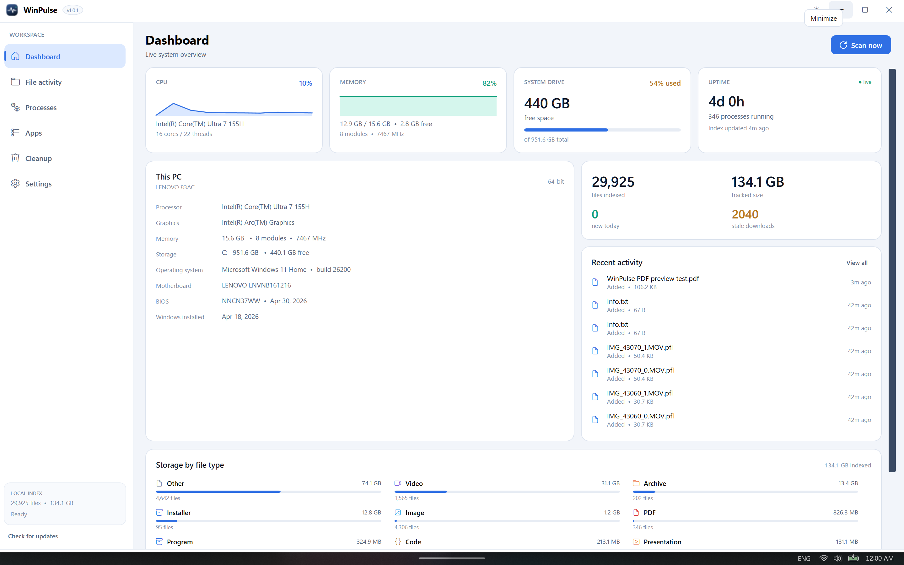
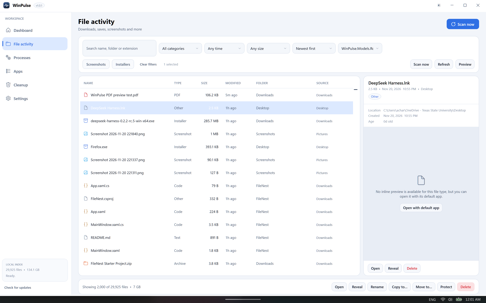
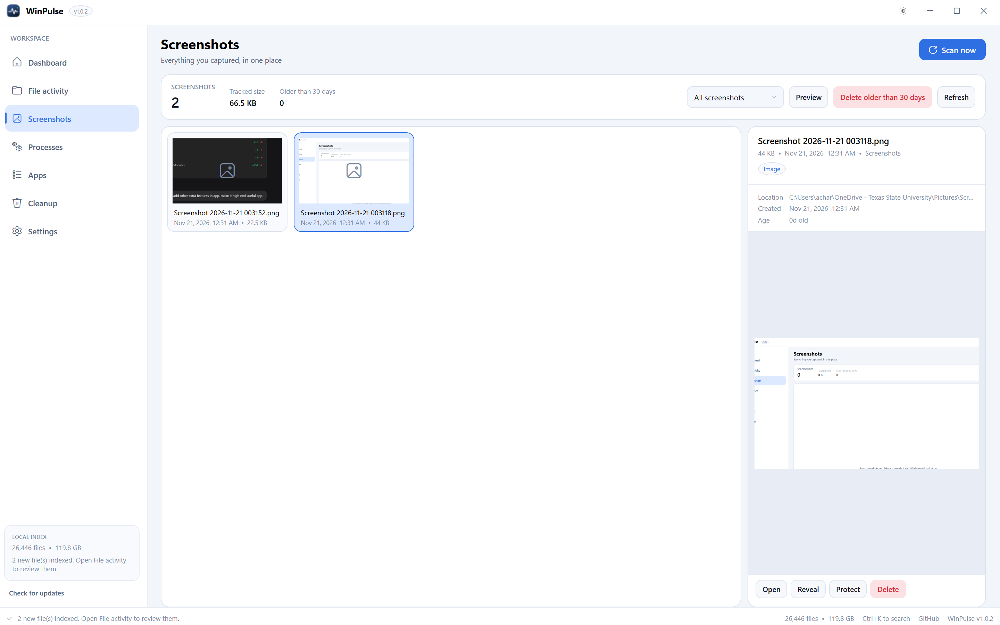
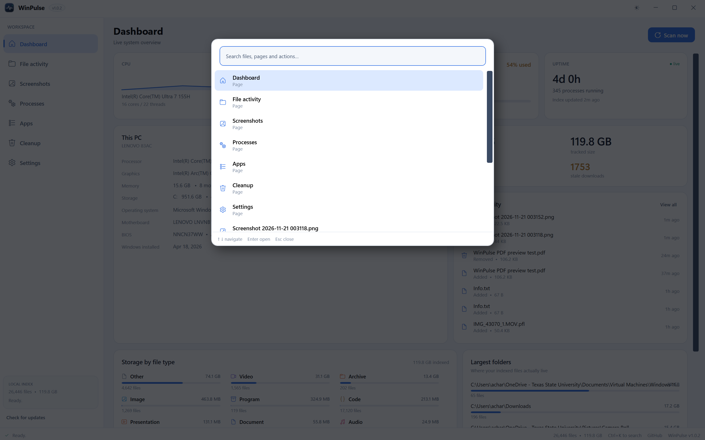

# WinPulse

<p align="center">
  
</p>

<p align="center">
  <b>A fast, local-first Windows companion that shows what your PC is doing — and what is quietly piling up in your folders.</b>
</p>

<p align="center">
  .NET 8 · WPF · SQLite · 100% local · no telemetry
</p>

---

WinPulse is a native Windows app that answers the questions you keep forgetting to ask:

- *What did I download, save, or screenshot recently?*
- *Which files are eating 151 GB of my disk?*
- *What is my CPU, RAM, GPU and storage actually doing right now?*
- *Which apps did I install, and which installers are still lying around?*

It indexes your watched folders in the background, keeps a searchable timeline of every file (with size, type, age and source), previews files **inside the app**, and lets you open, reveal, rename, copy, move, protect or recycle-bin delete anything without leaving WinPulse.

<p align="center">
  
</p>
<p align="center">
  
</p>
<p align="center">
  
</p>
<p align="center">
  
</p>

## Highlights

### Live system dashboard
- CPU, memory and system-drive gauges with 60-second sparklines.
- Full hardware inventory: CPU, GPU + driver, RAM modules and speed, motherboard, BIOS, Windows build and install date, per-drive usage.
- Recent activity feed and storage breakdown by file category.

### File activity explorer
- Background index of **Downloads, Desktop, Documents, Pictures, Videos** — add any folder you like.
- Filters for **category, date range, file size, source folder** and free-text search; sort by newest, oldest, largest, smallest or name.
- One-click chips for **Screenshots** and **Installers**.
- Smart screenshot detection (name/path heuristics, not just extensions).
- Files belonging to a scan are diffed, so new and removed files are tracked as activity, not just a flat list.

### Real in-app preview
- Images (fast decode, zoomed to fit).
- Text and source code (first 512 KB, monospace, scrollable).
- PDFs (WebView2).
- Audio and video with play/pause/stop.
- Metadata + "open with default app" fallback for everything else.

### Do everything from the app
- Open, reveal in Explorer, copy path.
- Rename, copy to another folder, move to another folder (collision-safe naming).
- Delete to the **Recycle Bin** (undoable) with a confirmation dialog.
- Protect files so cleanup suggestions never touch them.

### Processes and apps
- Live process list (2s refresh) with CPU %, working set, publisher and start time.
- End task, open file location, copy executable path.
- Installed programs read from the uninstall registry (version, publisher, install date, size, uninstaller).
- Installers found in tracked folders, with open/delete actions.

### Cleanup that explains itself
- Large files, stale downloads, old screenshots, and **likely duplicate copies** (size + content hash).
- Preview a suggestion before deleting it, then open, reveal, rename, copy, move or protect it — the same actions as File activity, without leaving the page.
- One review list with reasons, multi-select, bulk recycle-bin delete, and protect.
- Tunable age threshold and large-file threshold.

### In-app updates
- WinPulse checks the latest GitHub release on launch (configurable).
- When an update exists, the title bar shows **Update available**; the update panel lets you read release notes, **download with progress inside the app**, then *Install and restart*.
- A small updater script swaps the installed files after exit and relaunches WinPulse.
- Optional GitHub token field for private repositories.

### Pro conveniences
- **Ctrl+K command palette** — jump to any page, run actions or find an indexed file by name with the keyboard.
- **Tray quick search** — left-click the tray icon or press **Ctrl+Shift+Space** from anywhere for a compact search popup over pages, actions and files.
- **Duplicate review dialog** — see every copy side by side, pick the keeper, recycle the rest (or auto-resolve whole scans).
- **Disk space history** — a free-space sample every 5 minutes, charted over 7 days on the dashboard.
- **System tray mode** — close the window and WinPulse keeps tracking; right-click for scan, pages and exit. Balloon notifications flag new large files and low disk space.
- **Screenshots gallery** — thumbnail wall of every capture, time filters, full preview and one-click "delete older than 30 days".
- **Largest folders analytics** — see which directories actually carry your 100+ GB.
- **CSV export** of any filtered file list, and **bulk duplicate resolution** (keep newest, recycle the rest).

## Install

### Option A — one-line installer (PowerShell)

```powershell
irm https://raw.githubusercontent.com/anil2020-ux/winpulse/main/scripts/install.ps1 | iex
```

Installs to `%LOCALAPPDATA%\Programs\WinPulse`, adds a Start Menu shortcut and an uninstall entry. No admin rights required.

If the repository is private, pass a token instead of using the one-liner:

```powershell
.\scripts\install.ps1 -Token $env:GITHUB_TOKEN
```

### Option B — portable zip

Download `WinPulse-win-x64.zip` from the [latest release](https://github.com/anil2020-ux/winpulse/releases/latest), extract anywhere and run `WinPulse.exe`. Portable builds do not support self-update; use the installer for that.

> Requires Windows 10/11 x64. The WebView2 runtime comes with Windows 11 and modern Windows 10; if PDF preview is blank, install [Edge WebView2 Runtime](https://developer.microsoft.com/microsoft-edge/webview2/).

## Build from source

```powershell
git clone https://github.com/anil2020-ux/winpulse.git
cd winpulse
dotnet build src/WinPulse/WinPulse.csproj -c Release
dotnet run --project src/WinPulse/WinPulse.csproj
```

Publish a single-file Windows build:

```powershell
dotnet publish src/WinPulse/WinPulse.csproj -c Release -r win-x64 --self-contained true `
  -p:PublishSingleFile=true -p:IncludeNativeLibrariesForSelfExtract=true `
  -p:EnableCompressionInSingleFile=true -o publish
```

The project builds with the .NET 8 SDK only — no C++ toolchain is needed.

### Verification

```powershell
# 26-check headless suite (database, scanner, filters, rename/copy, previews, duplicates)
WinPulse.exe --selftest

# Update plumbing (prints current vs latest GitHub release)
WinPulse.exe --check-updates

# Download and stage the update, then exit (used to verify end-to-end updates)
WinPulse.exe --update
```

## How it works

| Layer | Choice | Why |
|---|---|---|
| UI | WPF, custom theme | Zero native dependencies, fluid on Windows 11, dark/light |
| Runtime | .NET 8 self-contained | Single file, no runtime install for users |
| Index | SQLite (WAL) + batched upserts | Fast queries over tens of thousands of files |
| Scanning | Iterative walker + `FileSystemWatcher` debounce | Fast incremental diffs, skips noisy/system dirs |
| Metrics | Win32 (`GetSystemTimes`, `GlobalMemoryStatusEx`) + WMI for static specs | Cheap live sampling, detailed inventory once |
| Deletes | `SHFileOperation` with `FOF_ALLOWUNDO` | Always goes to the Recycle Bin |
| Updates | GitHub Releases API + staged updater script | Download/progress/install inside the app |

The index lives in `%LOCALAPPDATA%\WinPulse\winpulse.db`. No file contents are uploaded anywhere; the only network calls are to GitHub for update checks.

More detail in [docs/ARCHITECTURE.md](docs/ARCHITECTURE.md).

## Roadmap

- [ ] Per-file thumbnails and inline PDF thumbnails in the grid
- [ ] Screenshot-aware "capture folders" detection (Game Bar, Snipping Tool)
- [ ] Duplicate resolution wizard (keep newest, protect, delete rest)
- [ ] Tray mode and quiet background tracking
- [ ] Per-app file history (which process wrote the file)
- [ ] Store-app inventory via `PackageManager`

## License

MIT © 2026 Anil Acharya — see [LICENSE](LICENSE).
